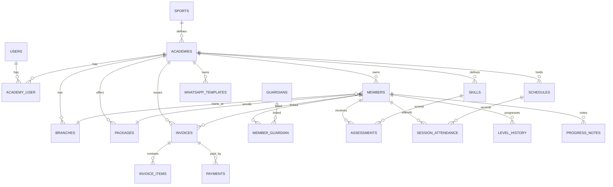

# Arenaku — Dokumen Implementasi
### Arsitektur, Skema Data, dan Rencana Pembangunan

> Pasangan dari `DESIGN.md`. Dokumen ini menjawab: **dibangun dengan apa, bagaimana strukturnya, dan urutan pengerjaannya.**

---

## 1. Rekomendasi Stack (paling mudah diimplementasikan)

### 1.1 Pilihan yang direkomendasikan

| Lapisan | Teknologi | Alasan |
|---|---|---|
| Backend | **Laravel 11** (PHP 8.3) | Ekosistem lengkap: auth, authorization, queue, scheduler, validasi, migration, testing |
| Frontend | **React 18 + TypeScript** lewat **Inertia.js** | Menulis React tanpa membuat API terpisah; routing & data loading ditangani Laravel |
| Styling | **Tailwind CSS 4** + komponen bergaya shadcn/ui | Cepat, konsisten, mudah dipoles |
| Build | **Vite** | Default Laravel, cepat |
| Database | **MySQL 8** (produksi) / **SQLite** (development) | Familiar, mudah backup, cocok untuk multi-tenant kolom |
| Auth | **Laravel Breeze (Inertia + React)** + **spatie/laravel-permission** | Breeze memberi scaffold login/register; permission mendukung "team" (akademi) |
| Charts | **Recharts** | Radar chart & line chart siap pakai |
| PDF | **barryvdh/laravel-dompdf** | Rapor, invoice, kwitansi |
| Excel | **maatsoftware/laravel-excel** (`maatwebsite/excel`) | Import member, export laporan |
| Peta | **Leaflet + OpenStreetMap** | Gratis, tanpa API key; simpan lat/lng |
| Gambar | **intervention/image** | Resize + kompresi foto member |
| Antrian | **Database queue** + `queue:work` (Supervisor) | Cukup untuk skala akademi; mudah dipindah ke Redis |
| Test | **Pest** | Sintaks ringkas, bawaan Laravel modern |

### 1.2 Kenapa Inertia + React, bukan React SPA terpisah?

| Aspek | Laravel API + React SPA | **Laravel + Inertia + React** |
|---|---|---|
| Jumlah repo/deploy | 2 | **1** |
| Auth | Token/Sanctum + refresh, CORS | **Session cookie bawaan Laravel** |
| Routing | Duplikasi (API + React Router) | **Route Laravel langsung** |
| Validasi | Dua tempat | **Satu di Form Request** |
| Waktu setup | Lebih lama | **Paling cepat** |
| Fleksibilitas | Bisa dipakai mobile app nanti | Bisa tambah `/api` kapan saja |

**Kesimpulan:** Inertia memberi pengalaman React penuh tanpa biaya kompleksitas API. Kalau nanti butuh mobile app, tambahkan endpoint API di aplikasi yang sama.

### 1.3 Alternatif (jika tim bukan React)

- **Laravel + Blade + Livewire + Alpine** — paling sedikit JavaScript, sangat cepat untuk CRUD. Cocok bila tim murni PHP. Kekurangan: komponen interaktif kompleks (radar chart live, absensi cepat) lebih repot.
- **Laravel API + React SPA** — pilih hanya jika sudah ada tim frontend terpisah.

### 1.4 Kebutuhan server minimal
- PHP 8.3, Composer 2, Node 20, MySQL 8.
- 2 vCPU / 2 GB RAM cukup untuk puluhan akademi.
- Storage untuk foto (lokal atau S3-compatible).

---

## 2. Arsitektur Aplikasi

```
┌──────────────────────────────────────────────────────────┐
│                  Browser (desktop & mobile)              │
│        React + Inertia + Tailwind (PWA-ready)            │
└──────────────────────────┬───────────────────────────────┘
                           │ HTTP (session cookie)
┌──────────────────────────▼───────────────────────────────┐
│                        Laravel                           │
│  Routes → Middleware (auth, role, academy scope)         │
│         → Controllers → Form Requests (validasi)         │
│         → Services (Billing, Assessment, Reminder, Wa)   │
│         → Policies (otorisasi per resource)              │
│         → Eloquent Models (global scope academy_id)      │
│         → Jobs & Scheduler (tagihan, reminder)           │
└───────────┬───────────────────────────┬──────────────────┘
            │                           │
     ┌──────▼──────┐             ┌──────▼──────────┐
     │   MySQL     │             │  Storage (foto) │
     └─────────────┘             └─────────────────┘
            │
     ┌──────▼───────────────────────────────┐
     │ Queue: notifikasi, export, kompresi  │
     └──────────────────────────────────────┘
```

Prinsip:
- **Controller tipis.** Logika bisnis di `app/Services`.
- **Satu Form Request per aksi tulis** untuk validasi konsisten.
- **Policy per model** untuk otorisasi.
- **Global scope tenancy** di trait `BelongsToAcademy`.
- **Semua aksi penting** dicatat di `activity_logs`.

---

## 3. Struktur Folder

```
arenaku/
├── app/
│   ├── Enums/
│   │   ├── AttendanceStatus.php
│   │   ├── InvoiceStatus.php
│   │   ├── MemberStatus.php
│   │   ├── SessionType.php
│   │   └── OutboxStatus.php
│   ├── Http/
│   │   ├── Controllers/
│   │   │   ├── Auth/
│   │   │   ├── AcademyController.php
│   │   │   ├── AcademyOnboardingController.php   (wizard buat akademi + akun awal)
│   │   │   ├── AccountController.php             (kelola akun admin/pelatih + kirim kredensial)
│   │   │   ├── BranchController.php
│   │   │   ├── MemberController.php
│   │   │   ├── GuardianController.php
│   │   │   ├── CoachController.php
│   │   │   ├── PackageController.php
│   │   │   ├── SkillController.php
│   │   │   ├── AssessmentController.php
│   │   │   ├── ScheduleController.php
│   │   │   ├── AttendanceController.php
│   │   │   ├── InvoiceController.php
│   │   │   ├── PaymentController.php
│   │   │   ├── ReminderController.php
│   │   │   └── ParentPortalController.php
│   │   ├── Middleware/
│   │   │   ├── EnsureAcademyMembership.php
│   │   │   ├── EnsurePasswordChanged.php   (paksa ganti password akun buatan admin)
│   │   │   └── SetCurrentAcademy.php
│   │   ├── Requests/
│   │   └── Resources/ (untuk endpoint API opsional)
│   ├── Models/
│   ├── Policies/
│   ├── Services/
│   │   ├── AcademyProvisioningService.php   (buat akademi + akun dalam 1 transaksi)
│   │   ├── AccountService.php               (buat user + kirim kredensial)
│   │   ├── BillingService.php
│   │   ├── AssessmentService.php
│   │   ├── AttendanceService.php
│   │   ├── ProgressionService.php
│   │   ├── ReminderService.php
│   │   └── WhatsApp/
│   │       ├── WhatsAppChannel.php       (interface)
│   │       ├── WaMeChannel.php           (implementasi MVP)
│   │       └── CloudApiChannel.php       (placeholder fase 5)
│   ├── Jobs/
│   │   ├── GenerateMonthlyInvoices.php
│   │   └── DispatchDueReminders.php
│   ├── Console/Commands/
│   │   ├── GenerateInvoicesCommand.php
│   │   └── DispatchRemindersCommand.php
│   └── Traits/
│       └── BelongsToAcademy.php
├── database/
│   ├── migrations/
│   ├── seeders/
│   └── factories/
├── resources/
│   ├── js/
│   │   ├── app.tsx
│   │   ├── Layouts/
│   │   │   ├── AdminLayout.tsx
│   │   │   ├── CoachLayout.tsx
│   │   │   └── ParentLayout.tsx
│   │   ├── Pages/
│   │   │   ├── Auth/
│   │   │   ├── Dashboard.tsx
│   │   │   ├── Academies/
│   │   │   ├── Members/
│   │   │   ├── Skills/
│   │   │   ├── Schedules/
│   │   │   ├── Attendance/
│   │   │   ├── Invoices/
│   │   │   ├── Reminders/
│   │   │   └── Portal/
│   │   ├── Components/
│   │   │   ├── ui/          (button, card, badge, modal, table, tabs)
│   │   │   ├── StatCard.tsx
│   │   │   ├── SkillRadar.tsx
│   │   │   ├── AttendancePicker.tsx
│   │   │   └── MapPreview.tsx
│   │   └── lib/
│   └── css/app.css
├── routes/
│   ├── web.php
│   ├── auth.php
│   └── console.php
├── tests/
│   ├── Feature/
│   │   ├── TenancyTest.php
│   │   ├── BillingTest.php
│   │   ├── AttendanceTest.php
│   │   ├── AssessmentTest.php
│   │   └── ParentPortalTest.php
│   └── Unit/
└── public/
```

---

## 4. Skema Database

### 4.1 ERD ringkas (Mermaid)



### 4.2 Tabel detail

**`users`**
| Kolom | Tipe | Catatan |
|---|---|---|
| id | bigint PK | |
| name | string | |
| email | string unique nullable | login bisa pakai email atau no. HP |
| phone | string unique | dinormalisasi `62…` |
| password | string | |
| avatar_path | string nullable | |
| locale | string default `id` | |
| is_active | boolean default true | |
| last_login_at | timestamp nullable | |
| must_change_password | boolean default false | `true` bila akun dibuat admin, wajib ganti saat login pertama |
| password_changed_at | timestamp nullable | |
| created_by | FK → users nullable | pencatat pembuat akun |
| timestamps, softDeletes | | |

**`sports`** (master cabang olahraga)
`id, name, slug, icon, is_active, timestamps`

**`academies`**
| Kolom | Tipe | Catatan |
|---|---|---|
| id | bigint PK | |
| sport_id | FK → sports | satu cabang utama per akademi |
| name, slug unique | string | |
| owner_user_id | FK → users | Super Admin/owner |
| logo_path | string nullable | |
| brand_color | string default `#0B1220` | |
| address, city, phone, email | | |
| timezone | string default `Asia/Jakarta` | |
| currency | string default `IDR` | |
| settings | json | aturan reminder, opt-out, dsb |
| status | enum(`active`,`inactive`,`suspended`) | |
| timestamps, softDeletes | | |

**`academy_user`** (keanggotaan + peran)
`id, academy_id, user_id, role enum(super_admin, admin, coach, parent, member), joined_at, is_active, created_by FK→users nullable, unique(academy_id,user_id,role)`

**`branches`** (lokasi/GOR)
`id, academy_id, name, address, city, latitude decimal(10,7), longitude decimal(10,7), maps_url, phone, is_active, timestamps`

**`packages`**
`id, academy_id, name, level enum(beginner,intermediate,advanced), monthly_price int, sessions_per_month int, duration_minutes int, quota int, branch_id, is_active, timestamps`
↳ `level` juga bisa memakai tabel `levels` bila ingin sub-level. Lihat **`levels`** di bawah.

**`levels`** (opsional, untuk sub-level)
`id, academy_id, name, sort_order, min_attendance_pct, min_skills_at_4, timestamps`

**`members`**
| Kolom | Tipe | Catatan |
|---|---|---|
| id | bigint PK | |
| academy_id, branch_id, package_id | FK | |
| member_code | string unique per academy | `BAD-2026-0042` |
| full_name, nickname | string | |
| photo_path | string nullable | |
| gender | enum(male,female) | |
| birth_date | date | |
| education_level | string | TK/SD/SMP/SMA/Kuliah/Umum |
| grade_class | string nullable | mis. `4A` |
| school_name | string nullable | |
| address, city, postal_code | | |
| joined_at | date | |
| level | enum(beginner,intermediate,advanced) | |
| status | enum(trial,active,inactive,alumni) | |
| primary_coach_id | FK → users nullable | |
| health_notes, allergy_notes | text nullable | |
| emergency_name, emergency_phone | string nullable | |
| source | string nullable | walk-in/IG/referral |
| notes | text nullable | |
| timestamps, softDeletes | | |
| index | (academy_id, status), (academy_id, level) | |

**`guardians`**
`id, academy_id, user_id nullable (kalau punya akun portal), full_name, relation enum(father,mother,guardian), phone, email nullable, occupation, address nullable, is_primary bool, timestamps`

**`member_guardian`**
`id, member_id, guardian_id, is_primary, unique(member_id, guardian_id)`

**`coach_profiles`**
`id, academy_id, user_id, license_number, specialization, bio, hourly_rate, photo_path, timestamps`

**`coach_member`** (penugasan)
`id, coach_id (user), member_id, assigned_at`

**`skill_categories`**
`id, sport_id, name, weight decimal(4,2) default 1.00, sort_order`

**`skills`**
`id, academy_id nullable (null = template global), sport_id, skill_category_id, name, description, rubric json, sort_order, is_active`

**`assessments`**
| Kolom | Tipe |
|---|---|
| id, academy_id, member_id, skill_id | FK |
| assessed_by | FK → users |
| score | tinyint (1–5) |
| note | text nullable |
| period | string `YYYY-MM` |
| assessed_at | date |
| timestamps | |
| index | (member_id, skill_id, assessed_at), (academy_id, period) |

**`progress_notes`**
`id, academy_id, member_id, coach_id, note, visibility enum(internal,parent), noted_at, timestamps`

**`schedules`**
| Kolom | Tipe | Catatan |
|---|---|---|
| id, academy_id, branch_id, package_id | FK | |
| type | enum(training,sparring,tournament,event) | |
| title | string | |
| coach_id | FK → users | |
| starts_at, ends_at | datetime | |
| location_name, address | string | GOR |
| latitude, longitude | decimal nullable | |
| maps_url | string nullable | |
| opponent_name, opponent_note | string nullable | sparring |
| status | enum(draft,published,completed,cancelled) | |
| is_recurring, recurrence_rule | bool, string nullable | |
| notes | text nullable | |
| created_by | FK → users | |
| timestamps | | |
| index | (academy_id, starts_at) | |

**`attendance_sessions`** (sesi aktual dari jadwal)
`id, academy_id, schedule_id nullable, branch_id, coach_id, title, session_date, started_at, ended_at, status enum(open,closed), notes, timestamps`

**`session_attendance`**
`id, attendance_session_id, member_id, status enum(present,late,permitted,sick,absent), check_in_at nullable, note nullable, timestamps, unique(session_id, member_id)`

**`invoices`**
| Kolom | Tipe |
|---|---|
| id, academy_id, member_id | FK |
| number | string unique |
| period_start, period_end, due_date | date |
| subtotal, discount, total | int |
| status | enum(draft,unpaid,partial,paid,overdue,void) |
| paid_at | datetime nullable |
| notes | text nullable |
| timestamps | |
| unique | (member_id, period_start, period_end) |

**`invoice_items`**
`id, invoice_id, description, qty, unit_price, amount`

**`payments`**
`id, academy_id, invoice_id, amount, method enum(cash,transfer,qris,other), reference nullable, proof_path nullable, paid_at, recorded_by, timestamps`

**`whatsapp_templates`**
`id, academy_id nullable, key, name, body text, variables json, is_active, timestamps`

**`notifications_outbox`**
`id, academy_id, channel default whatsapp, recipient_name, recipient_phone, template_key, payload json, message_body text, status enum(draft,queued,sent,failed,cancelled), related_type, related_id, scheduled_at, sent_at, sent_by, error_message, timestamps, index(academy_id,status,scheduled_at)`

**`level_history`**
`id, member_id, from_level, to_level, changed_by, reason, effective_at, timestamps`

**`announcements`**
`id, academy_id, title, body, audience enum(all,parents,coaches), published_at, created_by, timestamps`

**`activity_logs`**
`id, academy_id nullable, user_id nullable, action, subject_type, subject_id, properties json, ip, created_at`

**`settings`**
`id, academy_id nullable, key, value json, unique(academy_id,key)`

### 4.3 Aturan database
- Semua FK `onDelete('restrict')` kecuali data anak (soft delete).
- Uang disimpan sebagai **integer rupiah**, bukan float.
- Tanggal & waktu disimpan UTC, ditampilkan `Asia/Jakarta`.
- Index wajib: semua kolom `academy_id`, tanggal jadwal, status invoice, periode asesmen.

---

## 5. Multi-Tenancy

**Pendekatan:** shared database + `academy_id`.

```php
trait BelongsToAcademy
{
    protected static function bootBelongsToAcademy(): void
    {
        static::addGlobalScope('academy', function (Builder $builder) {
            if ($academyId = app(CurrentAcademy::class)->id()) {
                $builder->where($builder->getModel()->getTable().'.academy_id', $academyId);
            }
        });

        static::creating(function ($model) {
            if (! $model->academy_id) {
                $model->academy_id = app(CurrentAcademy::class)->id();
            }
        });
    }
}
```

- `CurrentAcademy` singleton diisi middleware `SetCurrentAcademy` dari session.
- Super Admin dapat mematikan scope lewat `withoutGlobalScope('academy')` **hanya** di halaman konsolidasi.
- Setiap Policy tetap memeriksa `academy_id` sebagai lapisan kedua.
- **Login menetapkan akademi aktif**: setelah autentikasi, sistem memilih keanggotaan user. Satu keanggotaan → langsung masuk; lebih dari satu → user memilih akademi/peran (disimpan di session).
- **Peran diambil per akademi**: `SetCurrentAcademy` juga mengeset team spatie ke `academy_id`, sehingga `hasRole()` hanya berlaku pada akademi aktif.
- **Akun buatan admin** wajib ganti password (`must_change_password`) sebelum memakai aplikasi, dijaga middleware `EnsurePasswordChanged`.
- **Test wajib**: user akademi A tidak bisa GET/PATCH resource akademi B (403/404).

---

## 6. RBAC & Permission Matrix

Menggunakan `spatie/laravel-permission` dengan **teams** = `academy_id`.

| Aksi | Super Admin | Admin Akademi | Pelatih | Orang Tua |
|---|---|---|---|---|
| Buat/nonaktifkan akademi | ✅ | ❌ | ❌ | ❌ |
| Buat admin/pelatih & kirim kredensial | ✅ | ✅ (di akademinya) | ❌ | ❌ |
| Kelola paket & lokasi | ✅ | ✅ | ❌ | ❌ |
| Tambah/edit member | ✅ | ✅ | ❌ | ❌ |
| Lihat data wali | ✅ | ✅ | read-only (kontak) | anak sendiri |
| Buat jadwal | ✅ | ✅ | usul (opsional) | ❌ |
| Absensi | ✅ | ✅ | ✅ | lihat |
| Input penilaian skill | ✅ | ✅ | ✅ (member yang diampu) | ❌ |
| Lihat keuangan | ✅ | ✅ | ❌ | tagihan anak |
| Konfirmasi pembayaran | ✅ | ✅ | ❌ | upload bukti |
| Kirim reminder WA | ✅ | ✅ | ❌ | ❌ |
| Lihat dashboard konsolidasi | ✅ | ❌ | ❌ | ❌ |

Catatan:
- **Pembuatan akademi hanya oleh Super Admin.** Menu "Buat Akademi" tidak dirender untuk admin akademi, dan route dijaga policy `create` pada `AcademyPolicy`.
- Peran (**role**) terikat pada pasangan `(user, academy)` — satu user boleh memiliki peran berbeda di akademi berbeda. Saat login, peran mengikuti akademi aktif.
- Pembuatan akun oleh admin menandai `must_change_password = true`; user wajib mengganti password sebelum mengakses modul lain.

---

## 7. Route Map (Inertia)

```php
Route::middleware(['auth','academy'])->group(function () {
    Route::get('/dashboard', DashboardController::class)->name('dashboard');

    // Super Admin — akademi & provisioning
    Route::resource('academies', AcademyController::class);            // create() = wizard multi-langkah
    Route::post('academies/onboarding', [AcademyOnboardingController::class,'store'])->name('academies.onboarding.store');
    Route::post('academies/{academy}/accounts', [AccountController::class,'store'])->name('academies.accounts.store');
    Route::post('academies/{academy}/accounts/{user}/resend', [AccountController::class,'resend'])->name('academies.accounts.resend');
    Route::resource('academies.branches', BranchController::class);
    Route::post('academies/{academy}/skills/template', [SkillTemplateController::class,'apply']);

    // Ganti password wajib (akun buatan admin)
    Route::get('password/force', [PasswordController::class,'edit'])->name('password.force');
    Route::put('password/force', [PasswordController::class,'update']);

    // Operasional
    Route::resource('members', MemberController::class);
    Route::post('members/import', [MemberImportController::class,'store']);
    Route::resource('members.guardians', MemberGuardianController::class)->shallow();
    Route::post('members/{member}/level-up', [LevelController::class,'store']);
    Route::resource('packages', PackageController::class);
    Route::resource('coaches', CoachController::class);

    // Skill & penilaian
    Route::resource('skills', SkillController::class);
    Route::get('assessments', [AssessmentController::class,'index'])->name('assessments.index');
    Route::post('members/{member}/assessments', [AssessmentController::class,'store']);
    Route::get('members/{member}/progress', [ProgressController::class,'show']);

    // Jadwal & absensi
    Route::resource('schedules', ScheduleController::class);
    Route::post('schedules/{schedule}/start', [AttendanceController::class,'start']);
    Route::get('attendance/{session}', [AttendanceController::class,'edit']);
    Route::put('attendance/{session}', [AttendanceController::class,'update']);
    Route::post('attendance/{session}/close', [AttendanceController::class,'close']);

    // Keuangan
    Route::resource('invoices', InvoiceController::class)->only(['index','show','store']);
    Route::post('invoices/generate', [InvoiceController::class,'generate']);
    Route::post('invoices/{invoice}/payments', [PaymentController::class,'store']);
    Route::post('invoices/{invoice}/void', [InvoiceController::class,'void']);

    // WhatsApp
    Route::get('reminders', [ReminderController::class,'index']);
    Route::post('reminders/queue', [ReminderController::class,'queue']);
    Route::post('reminders/{outbox}/sent', [ReminderController::class,'markSent']);
    Route::resource('whatsapp-templates', WhatsAppTemplateController::class);

    // Portal orang tua
    Route::get('portal', [ParentPortalController::class,'index'])->name('portal.index');
    Route::get('portal/children/{member}', [ParentPortalController::class,'show']);
    Route::get('portal/children/{member}/report', [ParentPortalController::class,'report']);
});
```

Tambahan route publik: landing akademi, pendaftaran trial, login/register, lupa password.

---

## 8. Alur Teknis Penting

### 8.1 Generate tagihan bulanan

```
Scheduler (tiap tanggal 1, 06:00 WIB)
  → GenerateMonthlyInvoices job
  → untuk setiap akademi aktif:
      untuk setiap member status=active:
        - tentukan periode (awal–akhir bulan)
        - skip jika invoice periode itu sudah ada
        - hitung: harga paket, prorata jika joined_at di tengah periode
        - terapkan diskon member / promo
        - buat invoice + item
        - status = unpaid (atau draft jika akademi mengaktifkan review)
  → log hasil + notifikasi ringkas ke admin
```

Rumus prorata:
```
sisa_hari = jumlah_hari_periode - tanggal_masuk + 1
total     = round(harga_bulanan * sisa_hari / jumlah_hari_periode / 1000) * 1000
```
Pembulatan ke ribuan terdekat agar nominal rapi.

### 8.2 Pengingat WhatsApp

```
Scheduler harian 08:00 WIB
  → DispatchDueReminders job
  → kandidat:
      a) invoice unpaid/partial dengan due_date = today+7 / today+3 / today+1
      b) invoice overdue dengan due_date = today-1
      c) schedule published dengan starts_at = besok
  → cek anti-duplikat: outbox dengan template+related_id+hari yang sama
  → render template dengan variabel
  → simpan outbox status=queued
  → admin membuka halaman Antrian → klik "Kirim via WhatsApp"
  → link wa.me/nomor?text=... → tandai sent
```

Interface channel:
```php
interface WhatsAppChannel
{
    public function link(string $phone, string $message): string;
    public function send(string $phone, string $message): bool; // fase Cloud API
}
```

### 8.3 Perhitungan progress

```
skor_kategori = Σ(skor × bobot_skill) / Σ(bobot_skill)
skor_total    = Σ(skor_kategori × bobot_kategori) / Σ(bobot_kategori)
delta         = skor_total_periode_ini − skor_total_periode_lalu
rekomendasi   = semua syarat level berikutnya terpenuhi
```

Syarat rekomendasi naik level (default, bisa diubah di `settings`):
- ≥ 80% skill memiliki skor ≥ 4
- kehadiran 3 bulan terakhir ≥ 80%
- tidak ada pelanggaran disiplin berat

### 8.4 Absensi
- Membuka sesi membuat snapshot member aktif pada paket tersebut.
- Update absensi memakai `upsert` per member.
- Menutup sesi mengunci data (`status=closed`); perubahan setelahnya oleh admin dan tercatat di `activity_logs`.
- Persentase kehadiran dihitung `(present + late) / total_sesi_tertutup`.

### 8.5 Provisioning akademi & akun (Super Admin)

```
Super Admin → wizard "Buat Akademi"
  → validasi tiap langkah lewat Form Request (data akademi, admin, pelatih, member)
  → DB::transaction:
      1. buat academy (sport_id, slug, settings awal, owner_user_id)
      2. copy template skill cabang → skills milik akademi
      3. per akun admin/pelatih: buat user (email/HP unik) + academy_user(role)
         + must_change_password = true, created_by = Super Admin
      4. member awal (opsional): buat member + wali + academy_user(parent)
  → commit
  → kirim kredensial tiap akun baru (email &/atau WhatsApp via notifications_outbox,
    template `kredensial_akun`)
  → catat di activity_logs
```

Aturan:
- Email/HP unik global. Jika sudah ada user dengan email/HP itu, tawarkan **pakai akun yang ada** (tambah baris `academy_user`) alih-alih membuat duplikat.
- Password di-generate acak bila operator tidak mengisi; dikirim sekali, wajib diganti saat login pertama.
- Kegagalan kirim kredensial **tidak membatalkan** pembuatan akademi; kredensial bisa dikirim ulang dari halaman kelola akun.
- Admin akademi dapat menambah akun pelatih/member di akademinya lewat `AccountController` (tanpa membuat akademi baru).

---

## 9. Integrasi WhatsApp (`wa.me`)

**Format nomor:** simpan `62812xxxxxxx`, tampilkan `0812-xxxx-xxxx`.

**Render template:**
```php
$body = str_replace(
    ['{{nama_anak}}','{{nama_wali}}','{{akademi}}','{{periode}}','{{jumlah}}','{{jatuh_tempo}}'],
    [$member->full_name, $guardian->full_name, $academy->name, 'November 2026', 'Rp 450.000', '10 Nov 2026'],
    $template->body
);
$url = 'https://wa.me/'.$guardian->phone.'?text='.rawurlencode($body);
```

**Pengembangan:** ganti `WaMeChannel` dengan `CloudApiChannel` tanpa mengubah controller, karena controller hanya memanggil interface.

---

## 10. Upload & Media

- Foto member & pelatih: maks 2 MB, `jpg/png/webp`.
- Crop persegi 1:1, simpan 2 ukuran: `thumb` 240px dan `full` 800px.
- Nama file: `members/{academy_id}/{member_id}-{uuid}.webp`.
- Validasi MIME sebenarnya (`mimes:jpg,png,webp` + `image` rule), bukan hanya ekstensi.
- Bukti pembayaran: PDF/JPG maks 5 MB, akses privat (signed URL).
- Hapus file lama saat foto diganti.

---

## 11. Peta

- Simpan `latitude`, `longitude`, `maps_url`.
- Form lokasi memakai Leaflet + pencarian Nominatim (opsional) untuk memilih titik.
- Tampilan detail: peta Leaflet statis (tanpa interaksi berat) + tombol `Buka di Google Maps`.
- Link universal: `https://www.google.com/maps/search/?api=1&query={lat},{lng}`.

---

## 12. Keamanan & Privasi Data Anak

- **Otorisasi berlapis:** middleware academy → policy → scope query.
- **Validasi** seluruh input dengan Form Request (termasuk nomor telepon regex `^62[0-9]{8,14}$`).
- **Rate limit** login (5/menit) dan endpoint pengiriman reminder.
- **Password** bcrypt/argon2 default Laravel.
- **CSRF** aktif; cookie `SameSite=Lax`, `Secure` di produksi.
- **Upload** dipindai tipe file, disimpan di luar public root atau disk privat.
- **Log** tidak menulis nomor HP lengkap (mask `62812****789`).
- **Akses orang tua** memakai policy yang memeriksa relasi `member_guardian` → `guardian.user_id`.
- **Hak data (UU PDP):** persetujuan wali saat pendaftaran, mekanisme ekspor & hapus data, retensi keuangan sesuai kebutuhan audit.
- **Backup** harian database + storage, uji restore berkala.

---

## 13. Performa

- Eager loading relasi pada tabel member & invoice (`with(['package','branch','primaryGuardian'])`).
- Pagination 15–25 baris.
- Cache dashboard 5 menit (key per akademi).
- Index komposit untuk query umum.
- Foto dikompresi & disajikan lewat cache header.
- Export besar dijalankan di queue, hasil diunduh via signed URL.

---

## 14. Testing

| Jenis | Contoh kasus |
|---|---|
| Feature | Admin akademi A tidak bisa mengakses member akademi B (403) |
| Feature | Hanya Super Admin bisa membuka/menyimpan wizard buat akademi (admin akademi → 403) |
| Feature | Wizard membuat akademi + akun admin/pelatih sekaligus; jika gagal → seluruh transaksi rollback |
| Feature | Akun buatan admin wajib ganti password sebelum mengakses modul lain |
| Feature | Kredensial akun baru tercatat terkirim di `notifications_outbox` |
| Feature | Orang tua hanya melihat anak yang terhubung |
| Feature | Generate invoice tidak membuat duplikat periode |
| Feature | Prorata benar untuk tanggal masuk tanggal 16 |
| Feature | Absensi terkunci setelah sesi ditutup |
| Feature | Reminder H-3 terkirim sekali saja per invoice |
| Unit | Rumus skor berbobot & delta |
| Unit | Normalisasi nomor telepon 08… → 62… |
| Unit | Aturan rekomendasi naik level |

Target: semua route utama punya minimal 1 happy path + 1 authorization test.

---

## 15. Seed & Data Demo

Seeder membuat:
- 1 Super Admin (`super@arenaku.test` / `password`)
- 1 admin akademi + 2 pelatih per akademi (akun siap login; `must_change_password` dimatikan untuk demo)
- 4 akademi: Arenaku Badminton Club, Aqua Sprint Swimming, Taekwondo Nusantara, Garuda Muda FC
- 2 lokasi per akademi
- 3 paket per akademi (Beginner/Intermediate/Advanced)
- 24 member badminton + wali + foto placeholder
- 3 pelatih
- 8 sesi latihan + 1 sparring (dengan koordinat GOR)
- Penilaian skill 3 periode untuk 12 member
- 30 invoice dengan variasi status
- 6 template WhatsApp

Gunakan factory + faker Indonesia (`id_ID`).

---

## 16. Deployment

**Opsi termudah**
1. VPS 2 GB (Ubuntu 24.04) + Nginx + PHP-FPM 8.3 + MySQL 8.
2. `git clone`, `composer install --no-dev`, `npm ci && npm run build`.
3. `php artisan migrate --force`, `storage:link`, `config:cache`.
4. Supervisor untuk `queue:work` dan cron `* * * * * php artisan schedule:run`.
5. HTTPS via Let's Encrypt.
6. Backup harian: `mysqldump` + rsync storage ke object storage.

**Alternatif tanpa server:** Laravel Cloud / Laravel Forge / Ploi. Untuk demo cepat: SQLite + `php artisan serve` di laptop.

---

## 17. Milestone & Checklist

### M0 — Setup
- [ ] `laravel new arenaku` + Breeze (React + TypeScript)
- [ ] Install Tailwind, spatie/laravel-permission, intervention/image, dompdf, laravel-excel
- [ ] Setup database & konfigurasi `.env`
- [ ] Layout admin (sidebar, topbar, komponen UI dasar)

### M1 — Fondasi multi-akademi
- [ ] Migrasi: sports, academies, academy_user, branches (+ kolom akun: `must_change_password`, `password_changed_at`, `created_by`)
- [ ] Middleware `SetCurrentAcademy`, `EnsureAcademyMembership`, `EnsurePasswordChanged`, trait `BelongsToAcademy`
- [ ] **Wizard buat akademi (Super Admin)**: data akademi → akun admin → pelatih → member → review
- [ ] `AcademyProvisioningService` + `AccountService` (buat akun + kirim kredensial, satu transaksi)
- [ ] Login menetapkan akademi aktif + pemilih akademi/peran bila >1 keanggotaan
- [ ] Academy switcher + CRUD akademi (Super Admin) + kelola akun (tambah/kirim ulang kredensial)
- [ ] CRUD lokasi/GOR
- [ ] Seeder master cabang olahraga & template skill
- [ ] Test tenancy & provisioning

### M2 — Member & wali
- [ ] Migrasi members, guardians, member_guardian, levels
- [ ] CRUD member + upload/crop foto
- [ ] CRUD wali + relasi wali utama
- [ ] Kode member otomatis
- [ ] Filter (akademi, level, status, pencarian)
- [ ] Import CSV/Excel + validasi baris
- [ ] Kartu member (opsional cetak)

### M3 — Jadwal & absensi
- [ ] Migrasi schedules, attendance_sessions, session_attendance
- [ ] CRUD jadwal + recurring + peta
- [ ] Mulai sesi → snapshot member
- [ ] UI absensi cepat (mobile friendly)
- [ ] Tutup sesi + rekap
- [ ] Test authorization pelatih

### M4 — Skill & progress
- [ ] Migrasi skill_categories, skills, assessments, progress_notes, level_history
- [ ] CRUD skill + rubrik
- [ ] Form penilaian per member/periode
- [ ] Perhitungan skor berbobot + delta
- [ ] Radar chart + tren
- [ ] Catatan pelatih (internal/parent)
- [ ] Rekomendasi naik level

### M5 — Keuangan
- [ ] Migrasi invoices, invoice_items, payments
- [ ] Generate tagihan + prorata + anti-duplikat
- [ ] Pencatatan pembayaran + upload bukti
- [ ] Rekap & filter periode
- [ ] Invoice/kwitansi PDF
- [ ] Test perhitungan

### M6 — WhatsApp
- [ ] Migrasi whatsapp_templates, notifications_outbox
- [ ] CRUD template + preview variabel
- [ ] Command dispatch reminder (tagihan & jadwal)
- [ ] Halaman antrian + tombol `wa.me`
- [ ] Anti-duplikat + jam tenang + opt-out
- [ ] Riwayat & status

### M7 — Portal orang tua
- [ ] Policy akses anak
- [ ] Dashboard anak (mobile-first)
- [ ] Progress & absensi
- [ ] Tagihan + upload bukti
- [ ] Jadwal + maps
- [ ] Rapor PDF

### M8 — Dashboard, laporan, polish
- [ ] KPI & grafik
- [ ] Laporan + export
- [ ] Audit log
- [ ] Empty states, loading, error handling
- [ ] Uji aksesibilitas & responsif
- [ ] Seed demo lengkap + dokumentasi

---

## 18. Environment Variables Penting

```env
APP_NAME=Arenaku
APP_URL=https://arenaku.id
APP_TIMEZONE=Asia/Jakarta

DB_CONNECTION=mysql
DB_DATABASE=arenaku
DB_USERNAME=arenaku
DB_PASSWORD=secret

QUEUE_CONNECTION=database
FILESYSTEM_DISK=public

# WhatsApp (MVP: wa.me)
WA_DRIVER=wame
WA_DEFAULT_COUNTRY_CODE=62
WA_QUIET_HOURS_START=21
WA_QUIET_HOURS_END=07

# Peta (opsional, jika memakai geocoding)
MAPS_GEOCODER=nominatim
```

---

## 19. Keputusan Teknis Ringkas

| Pertanyaan | Keputusan |
|---|---|
| Monolith atau microservice? | **Monolith modular** — paling murah dirawat |
| Siapa boleh buat akademi? | **Hanya Super Admin** |
| Pembuatan akademi | Wizard terpadu: akademi + akun admin/pelatih/member dalam **satu transaksi** |
| Akun baru | Dibuat langsung + kirim kredensial (email/WA); wajib ganti password saat login pertama |
| Peran user | Per akademi (`academy_user` + spatie teams = `academy_id`); satu user boleh multi-peran lintas akademi |
| API terpisah? | **Tidak** untuk MVP; Inertia. Tambah `/api` saat butuh mobile app |
| Multi-tenant? | Shared DB + `academy_id` + global scope |
| Database? | MySQL 8 produksi, SQLite saat development |
| Antrian? | Database queue, upgrade Redis bila ramai |
| WhatsApp? | `wa.me` di MVP, interface siap untuk Cloud API |
| Skill per cabang? | Template global (`academy_id = null`) yang bisa di-copy & diedit per akademi |
| Uang? | Integer rupiah, bukan desimal |
| Waktu? | Simpan UTC, tampil WIB |
| Foto? | WebP + 2 ukuran, disk privat untuk bukti bayar |

---

## 20. Langkah Mulai Cepat (untuk developer)

```bash
# 1. Buat proyek
laravel new arenaku
cd arenaku
composer require inertiajs/inertia-laravel spatie/laravel-permission \
  intervention/image barryvdh/laravel-dompdf maatwebsite/excel
npm install @inertiajs/react react react-dom recharts leaflet \
  lucide-react clsx tailwind-merge

# 2. Breeze dengan React + TypeScript
php artisan breeze:install react --typescript
npm install && npm run build

# 3. Migrasi awal
php artisan migrate
php artisan db:seed

# 4. Jalankan
php artisan serve
npm run dev
```

Urutan pengerjaan yang disarankan mengikuti milestone M0 → M8. Jangan mengerjakan keuangan sebelum struktur member & paket stabil, karena invoice bergantung pada keduanya.

---

## 21. Referensi Silang

- Aturan produk & UX: `DESIGN.md`
- Prototype yang bisa diklik: `prototype/index.html`
- Ringkasan proyek: `README.md`
